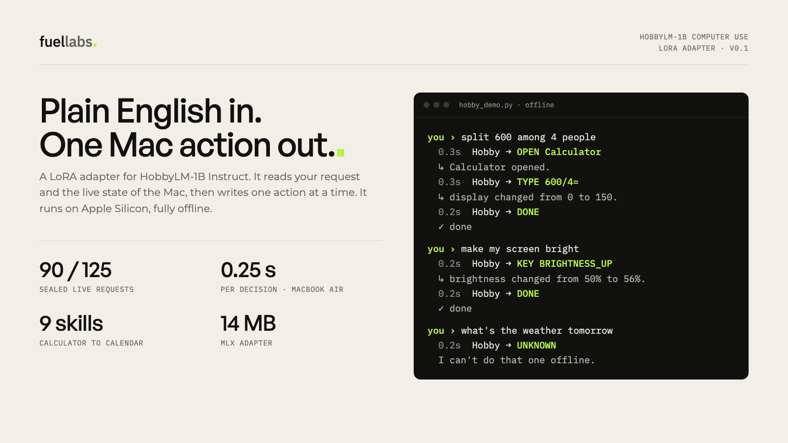
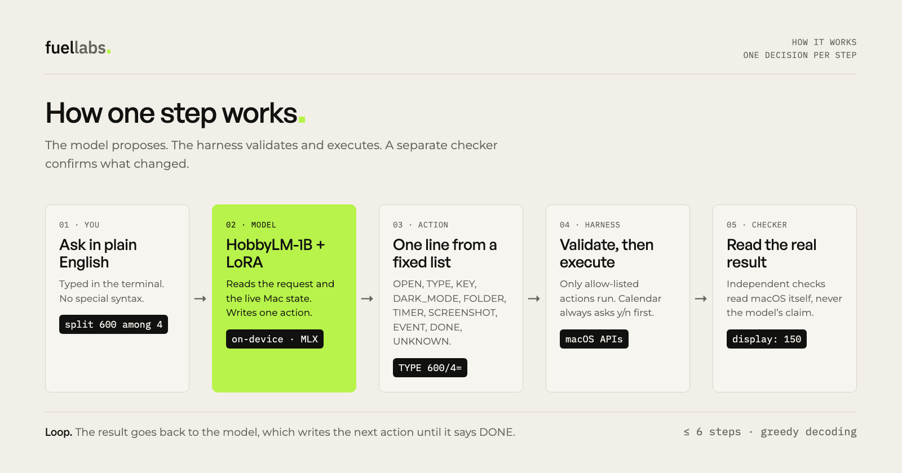
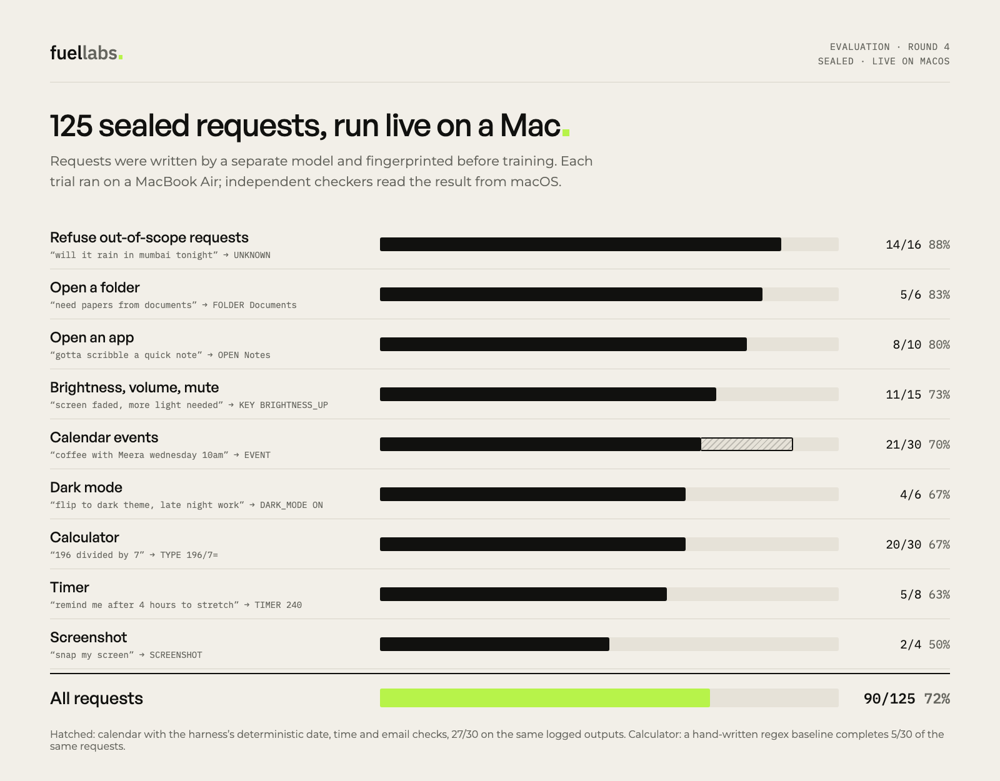
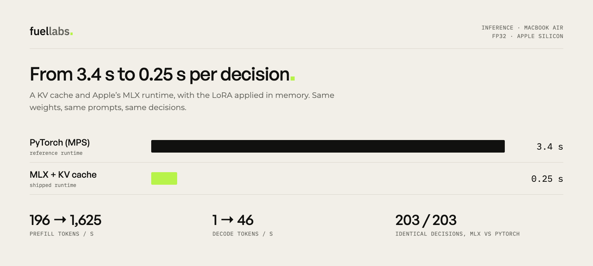

# Hobby: on-device computer use with HobbyLM-1B



Hobby turns plain-English requests into actions on a Mac, one step at a time, running entirely on the device. The decisions come
from [**HobbyLM-1B Computer Use**](https://huggingface.co/Hobbylm/hobbylm-1B-computer-use), a LoRA adapter for HobbyLM-1B Instruct.
This repository holds the app, the harness, the evaluation suite and the training pipeline.

- **90 of 125** sealed requests completed live on macOS (72%)
- **0.25 s** per decision on a MacBook Air (Apple MLX, FP32)
- **9 skills:** Calculator, brightness, volume, dark mode, apps, folders, timers, screenshots, calendar events, plus knowing when
  to say no
- **14 MB** adapter, trained in 4 rounds on 60 H100-minutes

## Quickstart

**Requirements:** an Apple-silicon Mac, macOS 14 or later, Python 3.10 to 3.13 and the Xcode command-line tools.

```bash
git clone https://github.com/Prajhan26/HobbyLM && cd HobbyLM/computer-use
./scripts/setup.sh
.venv/bin/python hobby/hobby_demo.py r4
```

`setup.sh` installs pinned packages and downloads HobbyLM-1B Instruct, the MLX runtime and the adapter. It also builds
[`mcp-server-macos-use`](https://github.com/mediar-ai/mcp-server-macos-use) at a pinned commit and compiles the Swift helpers.
Hobby runs offline from then on.

```text
you › split 600 among 4 people
  0.3s  Hobby → OPEN Calculator
  ↳ Calculator opened.
  0.3s  Hobby → TYPE 600/4=
  ↳ display changed from 0 to 150.
  0.2s  Hobby → DONE
  ✓ done
```

**Permissions.** You grant these in System Settings; Hobby never grants anything itself.

- **Accessibility:** for the app that runs Hobby. Hobby checks this at startup.
- **Calendar and Contacts:** for calendar events only. Turn the skill on with `HOBBY_ENABLE_CALENDAR=1`, and pick a calendar with
  `HOBBY_CALENDAR="<calendar name>"`.

Press Ctrl-C to quit, or Esc to stop a UI action.

## Skills

| Skill | Example request | Action |
|---|---|---|
| Calculator | `split 600 among 4 people` | `OPEN Calculator` → `TYPE 600/4=` → `DONE` |
| Brightness | `screen faded, more light needed` | `KEY BRIGHTNESS_UP` |
| Volume | `sound is harsh, turn it down a notch` | `KEY VOLUME_DOWN` |
| Mute | `mute everything` | `KEY MUTE` |
| Dark mode | `flip to dark theme, late night work` | `DARK_MODE ON` |
| Open an app | `gotta scribble a quick note` | `OPEN Notes` |
| Open a folder | `need papers from documents` | `FOLDER Documents` |
| Timer | `remind me after 4 hours to stretch` | `TIMER 240` |
| Screenshot | `snap my screen` | `SCREENSHOT` |
| Calendar event | `coffee with Meera wednesday 10am` | `EVENT Coffee with Meera \| wednesday \| 10:00 \| Meera`, then a y/n confirmation |
| Out of scope | `will it rain in mumbai tonight` | `UNKNOWN` |

## How it works



1. **The model writes one action.** Hobby sends the request and the live Mac state to the model, which writes one action from a
   fixed vocabulary of ten.
2. **The harness validates and executes it.** It checks the action against an allow-list and executes it: Calculator through
   `mcp-server-macos-use`, everything else through direct macOS calls.
3. **The result goes back to the model.** The model writes the next action until it writes `DONE`, with at most 6 steps.
4. **Calendar events are checked and confirmed.** Plain code resolves the date, time and time zone, copies emails exactly from
   the sentence and looks up Contacts. It always asks **y/n** before adding anything.

## Results



**How the tests were run:**

- A separate model wrote each round's tests, which were sealed (sha256) before training.
- Training lookalikes were removed by word-set Jaccard similarity.
- Every trial ran live on a MacBook Air, with independent checkers reading the result from macOS.

Full details are on the [model card](https://huggingface.co/Hobbylm/hobbylm-1B-computer-use) and in
[`docs/HOBBYLM_MAC_HELPER_TRAINING_2026-10-20.md`](docs/HOBBYLM_MAC_HELPER_TRAINING_2026-10-20.md).



## Reproduce

| Task | Command |
|---|---|
| Live sealed evaluation | `.venv/bin/python hobby/hobbymac_run.py --model trained --round r4 --adapter r4 --runtime mlx` |
| Score a run | `.venv/bin/python hobby/hobbymac_score.py <run folder>` |
| Harness unit tests (no model) | `.venv/bin/python hobby/test_offline.py` |
| Generate training data | `hobby/hobbymac_data.py` |
| Train an adapter on Modal (H100) | `modal run hobby/hobbymac_modal.py` |

The evaluation restores brightness, volume, appearance and windows after each trial. Calendar trials use a separate "Hobby Test"
calendar and never send invites.

## Repository layout

| Path | Contents |
|---|---|
| `hobby/` | App (`hobby_demo.py`), MLX and PyTorch runtimes, harness, checkers (`*.swift`), calendar tool, evaluation and training code |
| `data/` | Runtime adapter, retired sealed test sets, regex baselines, fixtures; built tools and run logs (git-ignored) |
| `docs/` | Training report, engineering and efficiency write-up, Calculator report, demo script |
| `assets/` | Figures |
| `models/`, `vendor/` | Created by `setup.sh` (git-ignored) |

## Licence and credits

- **Licence:** Apache-2.0.
- **Authors:** built by Hariharan and Prabhurajhan at Fuel Labs.
- **HobbyLM architecture:** inspired by the original HobbyLM work by Harish, who is not affiliated with Fuel Labs.
- **Dependency:** `mediar-ai/mcp-server-macos-use` is downloaded by `setup.sh`, not bundled. It is under the Business Source
  License 1.1, which permits non-commercial and educational production use and converts to MIT on 2028-04-09.
- **Related work:** UC Berkeley's TinyAgent.
